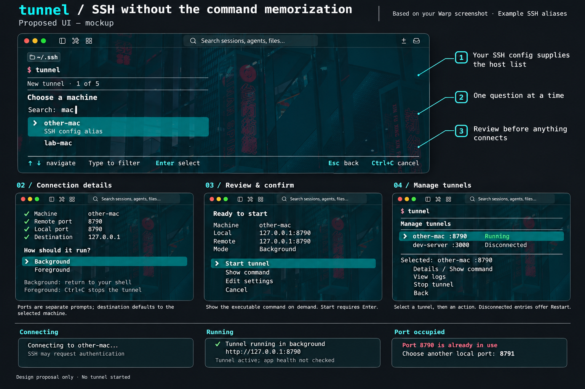

# tunnel — interactive SSH tunnel CLI

Status: v0.1.0 implementation baseline, 2026-11-04. This document specifies a standalone terminal utility. See [README.md](README.md) for installation, usage, and verification.

## 1. What we are building

A small terminal utility that makes a remote development application available on this Mac without memorizing an SSH command. Run `tunnel`, select an existing SSH-config alias, answer one question at a time, review the connection, and explicitly start it. Return later to inspect, stop, or restart tunnels created by the utility.

The motivating workflow is repeatedly accessing applications developed on another machine, with SSH connectivity already available. For example:

```sh
ssh -N -L 8790:127.0.0.1:8790 other-mac
```

The utility replaces remembering the forwarding syntax. It does not configure Tailscale, install a remote agent, or change the remote application. It runs on the machine where the local port and browser are needed. Tailscale is the user's existing network transport, not a required integration or proof that every configured host uses the tailnet.

Success means a first-time user can create a tunnel entirely through prompts, and a returning user can reuse or manage it without reconstructing the command.

## 2. Requirements and decisions

- Discover hosts from existing SSH configuration; users add machines to that configuration themselves.
- Ask one question at a time, with arrow-key selection and searchable host aliases.
- Show the exact commands and require confirmation before connecting.
- Support foreground and background execution, then list and manage owned tunnels.
- Keep recent successful settings and SSH diagnostics; browser opening is explicit.

The implementation uses Python + Questionary, system OpenSSH, and uv. The command is `tunnel`, background mode is the default, and local listeners bind only to `127.0.0.1`. A detached SSH process provides background operation; there is no persistent manager service.

The design originated in an interactive terminal workflow and a Warp-based mockup. The image below is a visual reference; the implemented behavior described here takes precedence where the image differs.

## 3. Original visual mockup



[Open the full-resolution mockup](design/tunnel-mockup.png) · [Original generation prompt](design/tunnel-mockup-prompt.txt)

This is an AI-generated design board, not a screenshot of the implemented CLI. Example aliases are illustrative, not discovered hosts. Cyan numbered labels are review annotations outside the product. Warp's wallpaper, toolbar, and window chrome belong to the terminal; the CLI renders only terminal text and prompts. The lower panels show separate moments, not simultaneous dashboard panes.

Interpret the board with these corrections:

- `New tunnel · 1 of 5` counts the five input stages only. Review is an additional stage. Prefer no numeric counter until the branching flow is implemented.
- The image uses **Show command** on demand; the earlier prose proposed displaying the exact command on the review screen. The implementation always shows the exact commands before Start.
- Ports are separate prompts even though the connection-details panel summarizes them together.
- Management selects a tunnel first, then displays its available actions.
- The example `http://127.0.0.1:8790` assumes an HTTP app. A TCP tunnel alone does not establish a protocol or a healthy application.

## 4. Version-one scope

| Included in v0.1.0 | Deferred |
|---|---|
| Local TCP forwarding through an existing SSH alias | Remote forwarding, SOCKS, UDP, Unix socket forwarding |
| Searchable keyboard-driven host selection | Editing SSH config or entering arbitrary SSH login details |
| Remote port, local port, and destination prompts | Service discovery and automatic remote port scanning |
| Foreground or detached SSH process | Installed daemon, startup service, automatic reconnect |
| Review, edit, cancel, and explicit start | One-click connection without confirmation |
| Owned-tunnel inventory, details, logs, stop, restart | Adopting or killing unrelated SSH sessions |
| Reuse of recent successful settings | Cloud accounts, synchronization, telemetry |
| macOS first; Warp is the visual reference | Guaranteed Linux/Windows support or a full-screen TUI |

One record represents one local forwarding route. Multiple routes can run as separate tunnels. The first version needs no server, database service, or SSH protocol implementation.

## 5. Interaction specification

### Entry point

```text
$ tunnel

  What would you like to do?
  ❯ New tunnel
    Manage tunnels · 2 running
    Recent tunnels
    Exit

  ↑ ↓ navigate   Enter select   Ctrl+C cancel
```

The running count is refreshed from owned connections, not trusted from saved state. Menus must work without color, keep the selected row identifiable, and avoid truncating meaningful port or destination information. Use short prompts and wrapping at ordinary terminal widths. No mouse interaction is required.

### Create a tunnel

| Stage | Prompt and behavior |
|---|---|
| Machine | Reload explicit aliases from SSH config. Type to filter; arrows navigate; Enter chooses an existing alias. No arbitrary host submission. |
| Remote port | Ask for the application's listening port, e.g. `8790`. Explain that this is not the SSH server port, which comes from SSH configuration. |
| Local port | Default to the remote port. Check availability; if occupied, keep the answer editable and offer a different port. Never silently change the route. |
| Destination | Default to `127.0.0.1` on the selected machine. Offer an advanced hostname/IP reachable from that machine. Explain whose loopback address this is. |
| Run mode | Background selected by default; Foreground available. State the lifetime and stop behavior before selection. |
| Review | Show alias, local endpoint, remote destination, mode, and access to the exact executable command. Offer Start tunnel, Edit settings, and Cancel. |

Review layout:

```text
  Ready to start

  Machine       other-mac
  Local         127.0.0.1:8790
  Destination   127.0.0.1:8790 on other-mac
  Mode          Background

  Command       [exact generated SSH command, wrapped as needed]

  ❯ Start tunnel
    Edit settings
    Cancel
```

The placeholder describes the design requirement. The implementation displays two exact invocations: an isolated SSH master with inherited forwards cleared, then the reviewed route added through its private control socket. This sequence was verified against an isolated macOS OpenSSH server. Do not display a simplified command that differs from execution.

Esc goes back and preserves answers; Ctrl+C cancels setup cleanly. At the main menu, cancellation exits. Editing an answer returns to review. No tunnel starts during selection, validation, command preview, or editing. Only selecting Start permits connection/authentication.

### Start and finish

Show `Connecting to <alias>…` and allow native SSH authentication and host-key prompts on the terminal. Do not report Running until SSH has established the requested local listener and management checks succeed. On failure, show an actionable reason and offer edit/retry/back; do not leave a successful-looking record.

In background mode, return control to the shell after confirmation of startup. Closing that terminal must not stop the SSH process. No restart after logout/reboot or reconnection after network failure is promised.

In foreground mode, remain attached and show `Ctrl+C stops this tunnel`. Ctrl+C must stop only that tunnel, update its record, and return to the shell. Closing the attached terminal ends the foreground session. Ctrl+C provides an explicit terminal stop gesture.

Show the local endpoint after success. Offer browser opening only as an explicit user action for a web application; never assume every TCP destination is HTTP or claim the app is healthy.

### Manage tunnels

`tunnel list` prints an inventory without opening an interactive picker. `tunnel` → Manage tunnels provides selection and actions. Optional `tunnel stop` and `tunnel restart` shortcuts may open the same picker; they are not needed to complete the primary flow.

| Action | Behavior |
|---|---|
| Details | Show stable tunnel ID, alias, endpoints, mode, creation time, observed status, and latest failure when available. |
| Show command | Show the launch command associated with the record; distinguish it from a newly generated restart command if config has changed. |
| View logs | Show available SSH diagnostics. Explain when no diagnostics exist. Do not imply application logs are collected. |
| Stop | Confirm the selected tunnel, stop it through its private control channel, then verify it has stopped. Never select another process based only on port number or PID. |
| Restart | Review the route and reconfirm. If currently running, stop and verify before starting a fresh instance; make the interruption clear. |
| Back | Return without changing a connection. |

### Recent tunnels

Remember successful connection settings without credentials. Selecting a recent entry pre-fills the wizard/review; it never connects immediately. Recheck that the alias still exists, the port is usable, and the saved inputs are valid. Reuse requires confirmation. An already-running equivalent route should lead to its management entry, not a duplicate listener.

## 6. Host discovery and validation

Discovery reads the user's SSH config and supported included files to find literal `Host` aliases. Deduplicate while preserving understandable ordering. A block can contain multiple aliases. Do not present wildcard or negated patterns as actual machines. Global wildcard settings still apply when native SSH connects.

The discovery reader is not an SSH configuration engine. OpenSSH remains responsible for connection settings, keys, users, SSH ports, jump hosts, and conditional configuration. Relative includes, quoting, glob expansion, nested includes, and cycles need fixtures. If a conditional or dynamic include cannot be enumerated reliably, explain the discovery limitation rather than claiming a complete host list. Picker discovery must not execute `Match exec` or other configured commands. The upstream [SSH configuration manual](https://man.openbsd.org/ssh_config) is the reference for syntax.

Validation requirements:

- Ports are decimal integers from 1 to 65535. Do not escalate privileges automatically for a bind failure.
- Destination is a supported hostname or IP address, not a shell fragment. Correct IPv6 formatting must be tested before advertising IPv6 destinations.
- The local listener is fixed to `127.0.0.1` in v1; no LAN/public bind option.
- Use an argument array for process execution, never a shell-interpolated command. Render a safely quoted representation separately for display.
- Revalidate before launch; a preflight port check cannot eliminate the race with another process binding that port.
- Do not read key contents, save passwords, replace known-host verification, or rewrite SSH config.

## 7. Lifecycle and ownership contract

Each managed tunnel receives a unique short control-socket path under a private user-owned directory. It must not join a pre-existing multiplexed session or inherit a shared control path. Stop/check operations target only that owned socket; no broad process search or PID-only kill fallback.

The intended primitive is system OpenSSH: local forwarding, foreground operation or backgrounding after authentication, and control-channel checks/exit. The official [ssh manual](https://man.openbsd.org/ssh) documents these facilities. The exact invocation must be tested against the installed macOS client before implementation is considered complete.

Startup must create only the reviewed forwarding route. Existing SSH config may specify other forwards or lifecycle settings; the implementation must detect conflicts and either safely isolate the requested route while preserving authentication/config resolution, or explain the unsupported configuration before connecting. Silently adding inherited forwards is unacceptable. Do not assume a forwarding-clearing option preserves a newly supplied forward without testing it.

| Display state | Meaning |
|---|---|
| Connecting | Startup is in progress; not yet a usable managed tunnel. |
| Running | Owned SSH control check succeeds and startup established the requested local forward. Application health remains unknown. |
| Stopped | The user explicitly stopped the tunnel and shutdown was verified. |
| Disconnected | A previously running tunnel no longer responds through its owned control channel. Show the last known failure if available; do not invent a cause. |
| Failed | The attempted launch did not complete successfully. Show diagnostics and retry/edit options. |
| Unknown | Permissions or another inspection error prevent a trustworthy determination. Do not label it Running or kill anything. |

Refresh on entering management and after each action. Stale saved state and socket files are not evidence of a running tunnel. Sleep, network loss, and reboot can invalidate connections; v1 offers manual restart. Forwarding startup checks do not verify the remote application, as documented for [ExitOnForwardFailure](https://man.openbsd.org/ssh_config#ExitOnForwardFailure).

## 8. Storage and stack

| Concern | Implemented choice |
|---|---|
| Language and packaging | Python, project dependencies managed with uv; expose a `tunnel` console entry point. |
| Prompts | Questionary 2.1.1 for prompts, with tested filter and Esc bindings. |
| CLI and processes | Python standard library; keep argument parsing and process orchestration small. |
| SSH | Installed system OpenSSH, retaining native authentication and config behavior subject to the explicit safety boundaries above. |
| Persistence | Small local JSON records and per-tunnel diagnostic files; no separate database or daemon. |
| Installation | uv tool installation from Git or a local checkout; package `ssh-tunnel-cli`, Python 3.11 or later. |

[Questionary's documented prompt types](https://questionary.readthedocs.io/en/stable/pages/types.html) cover selections, text validation, and autocomplete; they do not prove the whole pictured interaction is available without customization. [uv's tool installation](https://docs.astral.sh/uv/guides/tools/) provides isolated environments and CLI executables. Pin compatible versions during implementation rather than treating the stable docs label as a dependency lock.

Proposed record fields: schema version, stable ID, alias, local bind/port, remote address/port, mode, created time, last start/stop observation, private control path, log path, and last error. Keep input settings separately identifiable from observed status. Never trust the saved status as current truth.

State lives in the private `~/.tunnel/` directory. Use owner-only directory/file permissions, atomic record replacement, and serialization of concurrent mutations. If startup succeeds but saving the record fails, stop the newly created connection so it cannot become an unmanageable orphan. Preserve and report corrupt state rather than overwriting it. Bound diagnostic retention and exclude authentication input; never enable verbose credential-sensitive capture by default.

## 9. Required failure experiences

| Condition | Expected response |
|---|---|
| Missing config or no literal aliases | Explain how to add an alias manually, then offer reload/back. Do not create configuration. |
| Missing/unreadable include | Identify the file and show that the list may be incomplete. Do not silently claim complete discovery. |
| Invalid input | Explain the valid form beside the prompt and retain other answers. |
| Port occupied or bind fails | Offer another local port and return to review; no silent fallback or sudo. |
| Unknown host key/authentication request | Use native SSH prompts after Start; preserve verification and never store entered secrets. |
| Authentication, DNS, or network failure | Report the SSH failure without claiming a Tailscale diagnosis; offer retry/edit/back. |
| Remote app is down | Tunnel may still be Running. State that app health is not checked. |
| Cancellation during startup | Clean up any owned connection created by that attempt; no orphan or misleading Running entry. |
| Stale socket/state or reboot | Reconcile when inspected; keep settings available for a confirmed restart. |
| Unrelated SSH session on same host | Leave it unaffected by start/stop/restart of this utility's tunnel. |

## 10. Acceptance criteria and verification plan

These are acceptance criteria. Automated coverage is in `tests/`. Read the implementation verification notes below for coverage limits.

1. From `tunnel`, select an alias with the keyboard, enter ports, accept defaults, inspect the command, and start a usable local forward without typing SSH syntax.
2. Test host fixtures containing multiple aliases, duplicates, comments, quoted paths, wildcard/negated patterns, nested/globbed includes, cycles, and unsupported conditional discovery. Selection cannot submit an arbitrary host.
3. Back/edit preserve answers; cancelling at any pre-start stage creates no SSH connection. Invalid input and occupied ports cannot reach launch unchecked.
4. Verify command preview corresponds exactly to the argument array used for execution, including quoting and mode. Inputs cannot introduce shell execution or extra SSH options.
5. Against an isolated SSH test server and a known TCP/HTTP test app, verify foreground forwarding and Ctrl+C cleanup, then background forwarding after the initiating terminal closes.
6. Keep an independent SSH session open to the same host while testing stop/restart; it must remain connected. Test conflicting inherited forwards/control settings and shared-socket configurations.
7. Verify unknown-host and authentication prompts remain usable, failures produce truthful status, and no passwords or private key contents enter records/logs.
8. Stop/restart, failed launch, interrupted startup, record-write failure, simultaneous manager invocations, and stale records cannot leave an untracked owned connection or destroy records.
9. Stop the destination app while leaving SSH alive: the UI must distinguish tunnel state from app health. Simulate lost SSH connectivity and restart from saved settings after confirmation.
10. Inspect the actual UI in Warp at a normal terminal size, with long aliases and without color. Check navigation, readable errors, wrapped commands, and the full foreground/background lifecycle.

Build in three small steps: prove native SSH lifecycle and ownership in an isolated harness; add the config picker and reviewed start flow; then add records, management, recent settings, and the complete acceptance pass. Do not build a daemon or a framework around this workflow.

## 11. Design tradeoffs

Python + Questionary keeps the prompt flow and packaging small. Native OpenSSH handles authentication and connection configuration. A pair of explicit SSH commands isolates the selected forward from inherited forwarding settings. Recent settings, diagnostic viewing, and optional browser opening support repeated development use without adding a background manager.

The initial scope is macOS. Wider platform support, automatic reconnect, and a full-screen management interface are deferred. Engineering checks must continue to cover SSH lifecycle behavior, config discovery limits, and prompt bindings when dependencies change.

## 12. References

- [OpenSSH client manual](https://man.openbsd.org/ssh)
- [OpenSSH configuration manual](https://man.openbsd.org/ssh_config)
- [Questionary prompt documentation](https://questionary.readthedocs.io/en/stable/pages/types.html)
- [uv tool installation](https://docs.astral.sh/uv/guides/tools/)

## 13. Implementation decisions and verification

The implementation uses pinned Questionary 2.1.1 with uv, the Python standard library, and system OpenSSH. No external SSH library or manager daemon is added.

- State lives under private `~/.tunnel/` with atomic JSON replacement and a mutation lock. A short alternate `--state-dir` is supported for isolated use.
- Each reviewed start first opens a dedicated master with `ClearAllForwardings=yes`, then adds the selected route using `-O forward` with `ClearAllForwardings=no`. Commands for management use `-F /dev/null`; they do not re-evaluate connection config.
- Discovery resolves relative user Includes under `~/.ssh`. Conditional and dynamic Includes remain an explicitly warned limitation.
- Diagnostics are trimmed to 64 KiB when viewed, rather than rotated continuously by a daemon. Records remain until manually managed outside the app.
- Unit tests cover discovery, validation, command construction, private state, corruption, locking, and rollback. Opt-in integration tests use an isolated local sshd and generated test keys to check actual traffic, ownership, cancellation, stale/failed state, terminal closure, and native host-key confirmation.

The automated PTY tests are terminal interaction evidence, not manual verification in Warp. No existing SSH hosts, user keys, or Tailscale configuration are used by these tests. Password/passphrase authentication and platform support beyond macOS remain manual verification items.
